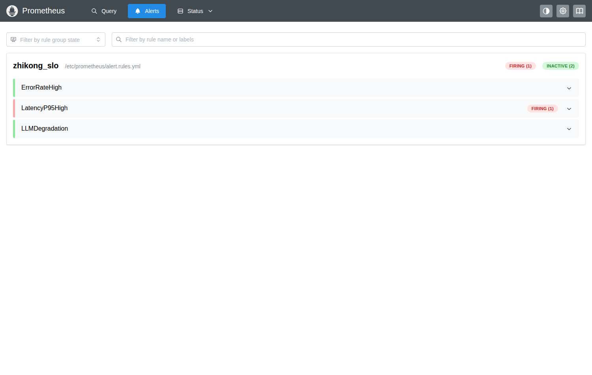
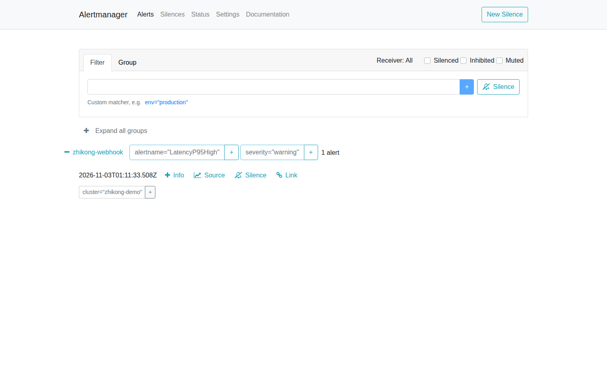

# 22 · 告警闭环验证：从"规则亮红灯"到"真的有人收到"

> 目的：简历/文档里写了 Prometheus 告警，就必须能回答"告警发到哪、谁收到过"。
> 本文记录一次**真实触发**的完整链路与证据，不是"我配置了"。

## 一、改之前是什么状态（诚实记录）

`monitoring/alert.rules.yml` 里写了三条 SLO 规则（错误率 / P95 延迟 / LLM 降级），
但 `prometheus.yml` 里是：

```yaml
alerting:
  alertmanagers:
    - static_configs:
        - targets: []      # ← 空的
```

**规则会算、页面会红，但没有任何接收端。** 这在生产里比不写更危险：
值班的人以为"有告警"，实际上没人会被通知。这也是原始文档里自己标注的遗留项。

## 二、改了什么（6 个文件）

| 文件 | 改动 |
|---|---|
| `monitoring/alertmanager.yml` | **新增**。单 receiver 路由 + 分组策略 + `send_resolved` |
| `monitoring/prometheus.yml` | `alertmanagers.targets` 从 `[]` → `['alertmanager:9093']` |
| `docker-compose.obs-only.yml` / `docker-compose.monitoring.yml` | 新增 `alertmanager` 服务；给 prometheus/alertmanager 加 `host.docker.internal` 映射 |
| `scripts/alert_webhook_receiver.py` | **新增**。本地 webhook 接收端，把 payload 落盘为证据 |
| `api/main.py` | **修监控盲区**：lifespan 起后台任务刷新 Gauge（见 §5.4） |
| `api/routers/system.py` | `/metrics` 改为纯内存渲染，不再在抓取路径查库 |

> 后两个文件不是"顺手改的"：它们解决的是"告警链路通了、但过载时不响"的根因，
> 详见 §5.2–5.4。

链路：

```
zhikong /api/v1/metrics
        │ scrape 15s
        ▼
   Prometheus ──规则评估──> 告警 firing
        │ POST /api/v2/alerts
        ▼
   Alertmanager ──route/group──> webhook
        │ POST /alert
        ▼
   alert_webhook_receiver.py → evidence/alert-deliveries.jsonl（+ 控制台留痕）
```

## 三、路由参数为什么这么配

| 参数 | 值 | 理由 |
|---|---|---|
| `group_by: [alertname, severity]` | 按告警名+级别分组 | 一次故障常同时点亮多条规则，不分组会变成告警风暴 |
| `group_wait: 5s` | 首次聚合等待 | 给同一批告警一个合并窗口；生产通常 30s，演示调短 |
| `group_interval: 10s` | 同组追加通知间隔 | 新告警加入同组时，不必等 repeat_interval |
| `repeat_interval: 30m` | 未恢复重复提醒 | 太短会疲劳，太长会漏掉"还在烧" |
| `send_resolved: true` | 恢复也发 | **没有 resolved 就无法区分"还在烧"和"已止血"**，这是最常见的告警设计缺陷 |

## 四、演练一：让 LLM 降级，而不是改阈值

**没有调低任何阈值，也没有伪造告警。** 做法是制造主模型的真实故障：

```bash
LLM_PROVIDER=openai \
OPENAI_API_KEY=test \
OPENAI_BASE_URL='http://127.0.0.1:9/v1'   # 9 端口关闭 → 连接被拒绝
LLM_TIMEOUT_SECONDS=2
```

每次提交都会走 `llm_gateway`：调用失败 → 重试耗尽 → **降级到规则模型** → 指标
`zhikong_llm_calls_total{outcome="fallback"}` +1。提交 3 次后：

```
zhikong_llm_calls_total{outcome="fallback",provider="openai:gpt-4o-mini"} 3.0
```

随后（15s 抓取 + 15s 评估 + 5s group_wait）：

| 环节 | 观测结果 |
|---|---|
| Prometheus 规则 | `LLMDegradation` → **firing**（`increase(...[10m]) = 2.52`） |
| Alertmanager | 1 条 active，receiver = `zhikong-webhook` |
| Webhook 接收端 | 收到 `firing`，落盘 `evidence/alert-deliveries.jsonl` |

送达耗时：`startsAt` 17:04:33Z → 接收端 `01:04:38`（UTC+8），**约 5 秒**。

### 证据 1：Prometheus 规则处于 FIRING


### 证据 2：Alertmanager 已接收并带有完整标签


注意标签：`outcome="fallback"`、`provider="openai:gpt-4o-mini"`、`job="zhikong"`、
`instance="zhikong:8000"`——**告警自带定位信息**，收到的人不用再问"哪台机器、哪个模型"。

### 证据 3：接收端落盘（可直接 grep）

```json
{
  "received_at": "2026-11-03T01:04:38",
  "status": "firing",
  "receiver": "zhikong-webhook",
  "alerts": [{
    "name": "LLMDegradation",
    "status": "firing",
    "severity": "warning",
    "summary": "LLM 降级被触发"
  }]
}
```

## 五、演练二：延迟告警——以及一个更严重的问题

### 5.1 先把阈值定对：3s → 800ms

原来的 `LatencyP95High > 3s` 是拍出来的：压测里 100 并发 P95 才 1.24s，
这条规则**在真实过载下都不会响**。改成 800ms 的依据（docs/21 实测）：

| 负载 | P95 |
|---|---|
| 10 并发 | 126ms |
| 25 并发 | 315ms |
| 100 并发 | 1097ms |

800ms 落在「正常负载的 2.5 倍」与「过载」之间，用户在明显感知之前就能收到预警。
同时给表达式加了路径过滤：`{path=~"/api/v1/workflow/submit.*"}`。
原来它混入了 `/health` 与 `/metrics`（都 <1ms），会把整体 P95 稀释掉——
**指标口径错了，阈值再准也没用**。

### 5.2 第一次压测：规则没响，但原因不是阈值

压 100 并发 4 分钟，真实延迟到了 4.8s，告警却始终 inactive；更奇怪的是，
查询 P95 一直返回同一个值 `0.2425` —— **指标不再更新了**。

查 `up{job="zhikong"}` 的历史：压测期间（00:59–01:01）一直是 `0`，压测结束才回到 `1`。
再看 `scrape_duration_seconds`：压测期间恒为 **10.0007s**，正好卡在 `scrape_timeout=10s`。

### 5.3 根因：监控和被监控共用同一个线程池

`/api/v1/metrics` 是同步端点，FastAPI 把它丢进默认线程池；而 100 个提交请求
（每个 4s）早已把线程池占满。抓取排在后面，等到 10 秒超时，Prometheus 判定 `up=0`。

**指标断流 → 规则看到的是"没有流量" → 延迟告警永远不会触发。**

这是最危险的一类故障：服务正在过载，监控却因为抓不到数据而沉默。
而且 `up=0` 通常被解读为"服务挂了"，运维第一反应是重启，而不是去看延迟。

### 5.4 修复：把 Gauge 刷新移出抓取路径

| 文件 | 改动 |
|---|---|
| `api/main.py` | lifespan 起后台任务，每 10s 刷新「待审批数 / 向量规模」两个 Gauge |
| `api/routers/system.py` | `/metrics` 只读内存渲染，不再查库 |

抓取耗时从 10s（超时）降到 **0.003s**，与业务负载彻底解耦。

### 5.5 复测：pending → firing → 送达

| 时间（本地） | up | P95 | 告警状态 |
|---|---|---|---|
| 09:09:20 | 1 | 0.242s | none |
| 09:09:35 | 1 | 4.775s | pending |
| 09:11:36 | 1 | 4.892s | **firing** |
| 09:11:38 | — | — | webhook 已收到 |

`for: 2m` 从 09:09:35 到 09:11:36 正好 2 分钟；送达延迟 2 秒。

### 证据 4：Prometheus 处于 FIRING



### 证据 5：Alertmanager 已接收



## 六、这次演练**没有**证明的事（边界）

1. **`ErrorRateHigh` 仍未真实触发。** 5xx 没有可靠的人工注入手段（压测全程零错误），
   它只验证了"表达式能算、页面能显示"，**没有验证送达**。
2. **webhook 不是生产通知渠道。** 真实落地要换成钉钉/飞书/企业微信机器人或 PagerDuty，
   本脚本的价值是**证明链路通**，不是替代通知系统。
3. **没有做告警抑制与静默流程。** 下游故障会连带点亮上游多条规则，生产需要
   `inhibit_rules` 与值班静默入口，否则告警会变成噪音。

## 七、面试问答

**Q：你的告警是怎么闭环的？**
A：指标 → Prometheus 规则 → Alertmanager 路由分组 → webhook 接收端落盘。
我做了两次真实演练：一次制造 LLM 不可用触发降级告警（5 秒送达），
一次用压测把 P95 打到 4.8s 触发延迟告警（`for: 2m` 后 2 秒送达）。都有截图和 JSONL。

**Q：为什么要做两次？**
A：第一次验证"链路能通"，第二次验证"过载时它真的会响"。这两件事不一样——
第二次就暴露出：链路是通的，但过载时指标抓不到，告警根本不会触发。

**Q：你是怎么发现抓不到指标的？**
A：压测时 P95 查询一直返回同一个值 0.2425，明显不更新。查 `up` 发现压测期间是 0，
再查 `scrape_duration_seconds` 正好卡在 10s 超时。根因是 `/metrics` 是同步端点、
和业务共用线程池，业务打满后抓取排不上队。

**Q：怎么修的？**
A：把 Gauge 刷新挪到 lifespan 的后台任务，`/metrics` 只读内存。
抓取耗时从 10s 降到 3ms，修完复测 `up` 全程为 1，告警 pending → firing → 送达。

**Q：group_wait 和 repeat_interval 怎么定？**
A：group_wait 是聚合窗口，给同一批告警合并的机会，生产 30s 左右；
repeat_interval 是未恢复提醒，30 分钟到 4 小时按严重程度定。critical 短、warning 长，
否则值班会被疲劳轰炸，最后所有人静音。

**Q：为什么 send_resolved 要开？**
A：没有恢复通知，收到告警的人无法判断"还在烧"还是"已经好了"，
只能自己去查——这会让告警从"通知"退化成"噪音"。

**Q：告警里怎么带定位信息？**
A：靠标签。这次 payload 里带了 `job/instance/outcome/provider`，
收到的人直接知道是哪个服务、哪个模型、什么原因降级，不用二次排查。

**Q：还差什么？**
A：两条延迟/错误率规则只验证了计算没验证送达；阈值该按 SLO 重定；
通知渠道要换成真实 IM；还缺告警抑制（下游挂了别让上游全红）和静默流程。

## 八、复现

```bash
# 1. 接收端（宿主机）
python scripts/alert_webhook_receiver.py --port 8099 --out evidence/alert-deliveries.jsonl

# 2. 观测栈（含 alertmanager）
docker compose -f docker-compose.obs-only.yml up -d

# 3. 应用：故意让主模型不可用
LLM_PROVIDER=openai OPENAI_API_KEY=test \
OPENAI_BASE_URL='http://127.0.0.1:9/v1' LLM_TIMEOUT_SECONDS=2 \
METRICS_TOKEN=zhikong-monitoring-demo-token \
python -m uvicorn api.main:app --host 0.0.0.0 --port 8000

# 4. 提交 3 次触发 fallback，然后观察
curl -s localhost:19090/api/v1/alerts | python3 -m json.tool
curl -s localhost:19093/api/v2/alerts | python3 -m json.tool
tail -f evidence/alert-deliveries.jsonl
```
