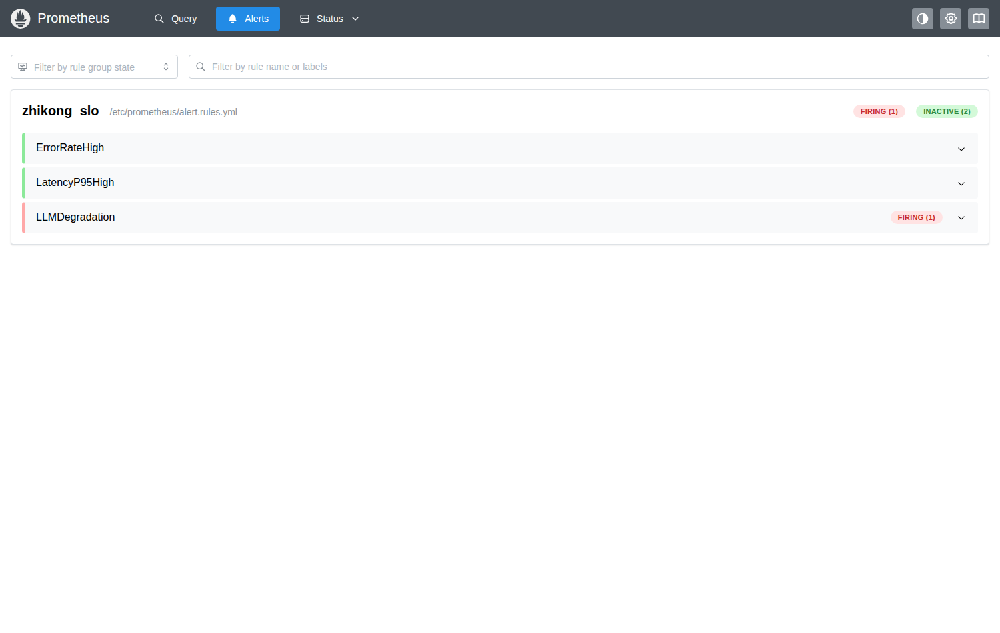
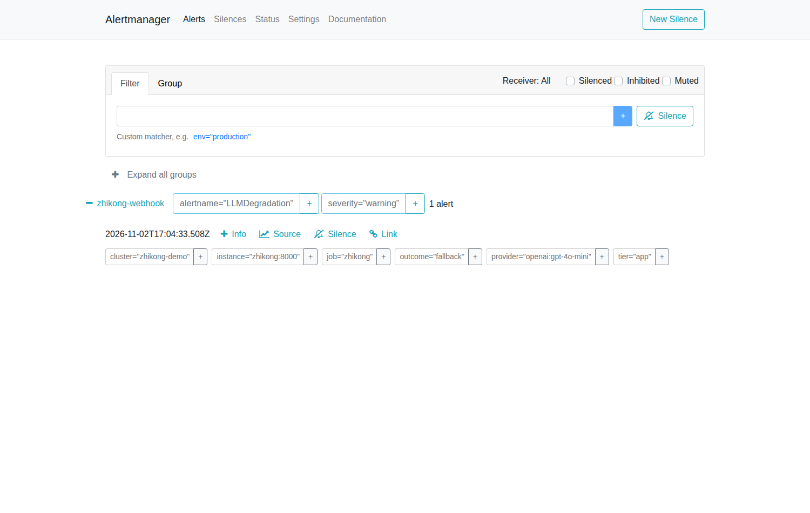

# 22 · 告警闭环验证：从"规则亮红灯"到"真的有人收到"

> 目的：简历/文档里写了 Prometheus 告警，就必须能回答"告警发到哪、谁收到过"。
> 本文记录一次**真实触发**的完整链路与证据，不是"我配置了"。

## 一、改之前是什么状态（诚实记录）

`monitoring/alert.rules.yml` 里写了三条 SLO 规则（错误率 / P95 延迟 / LLM 降级），
但 `prometheus.yml` 里是：

```yaml
alerting:
  alertmanagers:
    - static_configs:
        - targets: []      # ← 空的
```

**规则会算、页面会红，但没有任何接收端。** 这在生产里比不写更危险：
值班的人以为"有告警"，实际上没人会被通知。这也是原始文档里自己标注的遗留项。

## 二、改了什么（4 个文件）

| 文件 | 改动 |
|---|---|
| `monitoring/alertmanager.yml` | **新增**。单 receiver 路由 + 分组策略 + `send_resolved` |
| `monitoring/prometheus.yml` | `alertmanagers.targets` 从 `[]` → `['alertmanager:9093']` |
| `docker-compose.obs-only.yml` / `docker-compose.monitoring.yml` | 新增 `alertmanager` 服务；给 prometheus/alertmanager 加 `host.docker.internal` 映射 |
| `scripts/alert_webhook_receiver.py` | **新增**。本地 webhook 接收端，把 payload 落盘为证据 |

链路：

```
zhikong /api/v1/metrics
        │ scrape 15s
        ▼
   Prometheus ──规则评估──> 告警 firing
        │ POST /api/v2/alerts
        ▼
   Alertmanager ──route/group──> webhook
        │ POST /alert
        ▼
   alert_webhook_receiver.py → evidence/alert-deliveries.jsonl（+ 控制台留痕）
```

## 三、路由参数为什么这么配

| 参数 | 值 | 理由 |
|---|---|---|
| `group_by: [alertname, severity]` | 按告警名+级别分组 | 一次故障常同时点亮多条规则，不分组会变成告警风暴 |
| `group_wait: 5s` | 首次聚合等待 | 给同一批告警一个合并窗口；生产通常 30s，演示调短 |
| `group_interval: 10s` | 同组追加通知间隔 | 新告警加入同组时，不必等 repeat_interval |
| `repeat_interval: 30m` | 未恢复重复提醒 | 太短会疲劳，太长会漏掉"还在烧" |
| `send_resolved: true` | 恢复也发 | **没有 resolved 就无法区分"还在烧"和"已止血"**，这是最常见的告警设计缺陷 |

## 四、真实演练：让 LLM 降级，而不是改阈值

**没有调低任何阈值，也没有伪造告警。** 做法是制造主模型的真实故障：

```bash
LLM_PROVIDER=openai \
OPENAI_API_KEY=test \
OPENAI_BASE_URL='http://127.0.0.1:9/v1'   # 9 端口关闭 → 连接被拒绝
LLM_TIMEOUT_SECONDS=2
```

每次提交都会走 `llm_gateway`：调用失败 → 重试耗尽 → **降级到规则模型** → 指标
`zhikong_llm_calls_total{outcome="fallback"}` +1。提交 3 次后：

```
zhikong_llm_calls_total{outcome="fallback",provider="openai:gpt-4o-mini"} 3.0
```

随后（15s 抓取 + 15s 评估 + 5s group_wait）：

| 环节 | 观测结果 |
|---|---|
| Prometheus 规则 | `LLMDegradation` → **firing**（`increase(...[10m]) = 2.52`） |
| Alertmanager | 1 条 active，receiver = `zhikong-webhook` |
| Webhook 接收端 | 收到 `firing`，落盘 `evidence/alert-deliveries.jsonl` |

送达耗时：`startsAt` 17:04:33Z → 接收端 `01:04:38`（UTC+8），**约 5 秒**。

### 证据 1：Prometheus 规则处于 FIRING



### 证据 2：Alertmanager 已接收并带有完整标签



注意标签：`outcome="fallback"`、`provider="openai:gpt-4o-mini"`、`job="zhikong"`、
`instance="zhikong:8000"`——**告警自带定位信息**，收到的人不用再问"哪台机器、哪个模型"。

### 证据 3：接收端落盘（可直接 grep）

```json
{
  "received_at": "2026-11-03T01:04:38",
  "status": "firing",
  "receiver": "zhikong-webhook",
  "alerts": [{
    "name": "LLMDegradation",
    "status": "firing",
    "severity": "warning",
    "summary": "LLM 降级被触发"
  }]
}
```

## 五、这次演练**没有**证明的事（边界）

1. **另外两条规则没有真实触发。** `ErrorRateHigh` 需要 5xx > 5%，而压测全程零错误；
   `LatencyP95High` 阈值是 3s，压测实测 P95 峰值 1.24s（见 docs/21），够不到。
   → 它们只验证了"表达式能算、页面能显示"，**没有验证送达**。
2. **3s 的 P95 阈值偏松。** 压测显示 100 并发时 P95 已 1.24s、4 worker 时 2.3s，
   按经验延迟超过 1s 用户就有感知。合理做法是按 SLO 定（如"P95 < 800ms"），
   而不是拍一个 3s。这条留作 P1 整改项，不在本轮偷偷改小来"制造告警"。
3. **webhook 不是生产通知渠道。** 真实落地要换成钉钉/飞书/企业微信机器人或 PagerDuty，
   本脚本的价值是**证明链路通**，不是替代通知系统。

## 六、面试问答

**Q：你的告警是怎么闭环的？**
A：指标 → Prometheus 规则 → Alertmanager 路由分组 → webhook 接收端落盘。
我做过一次真实演练：把 LLM base_url 指向关闭端口，制造主模型不可用，
3 次降级触发 `LLMDegradation`，5 秒内送达接收端，有截图和 JSONL 记录。

**Q：为什么用 LLMDegradation 演练，不用延迟告警？**
A：因为它 `for: 0m` 且能真实复现，不需要等 2 分钟窗口，也不需要改阈值。
延迟告警的阈值是 3s，压测没够到——我不会为了让演示好看去调低阈值，那是自欺。

**Q：group_wait 和 repeat_interval 怎么定？**
A：group_wait 是聚合窗口，给同一批告警合并的机会，生产 30s 左右；
repeat_interval 是未恢复提醒，30 分钟到 4 小时按严重程度定。critical 短、warning 长，
否则值班会被疲劳轰炸，最后所有人静音。

**Q：为什么 send_resolved 要开？**
A：没有恢复通知，收到告警的人无法判断"还在烧"还是"已经好了"，
只能自己去查——这会让告警从"通知"退化成"噪音"。

**Q：告警里怎么带定位信息？**
A：靠标签。这次 payload 里带了 `job/instance/outcome/provider`，
收到的人直接知道是哪个服务、哪个模型、什么原因降级，不用二次排查。

**Q：还差什么？**
A：两条延迟/错误率规则只验证了计算没验证送达；阈值该按 SLO 重定；
通知渠道要换成真实 IM；还缺告警抑制（下游挂了别让上游全红）和静默流程。

## 七、复现

```bash
# 1. 接收端（宿主机）
python scripts/alert_webhook_receiver.py --port 8099 --out evidence/alert-deliveries.jsonl

# 2. 观测栈（含 alertmanager）
docker compose -f docker-compose.obs-only.yml up -d

# 3. 应用：故意让主模型不可用
LLM_PROVIDER=openai OPENAI_API_KEY=test \
OPENAI_BASE_URL='http://127.0.0.1:9/v1' LLM_TIMEOUT_SECONDS=2 \
METRICS_TOKEN=zhikong-monitoring-demo-token \
python -m uvicorn api.main:app --host 0.0.0.0 --port 8000

# 4. 提交 3 次触发 fallback，然后观察
curl -s localhost:19090/api/v1/alerts | python3 -m json.tool
curl -s localhost:19093/api/v2/alerts | python3 -m json.tool
tail -f evidence/alert-deliveries.jsonl
```
